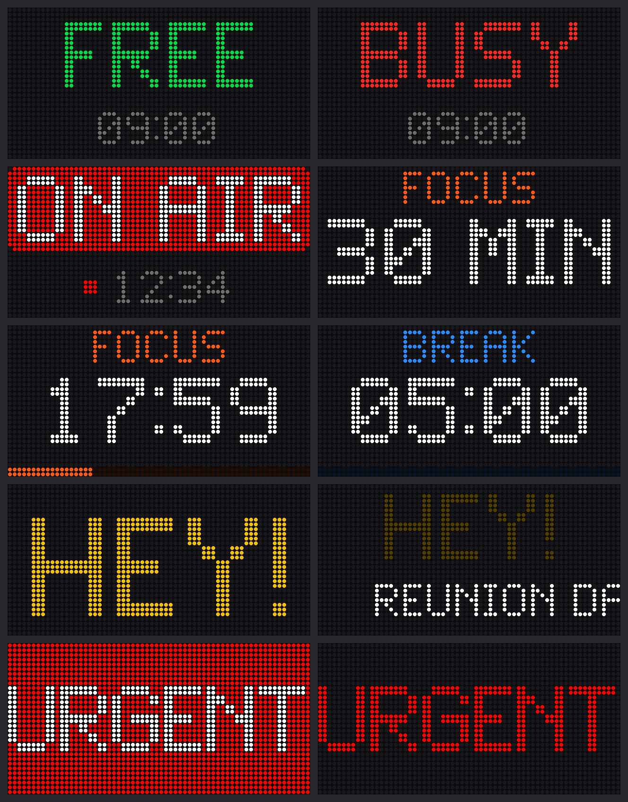
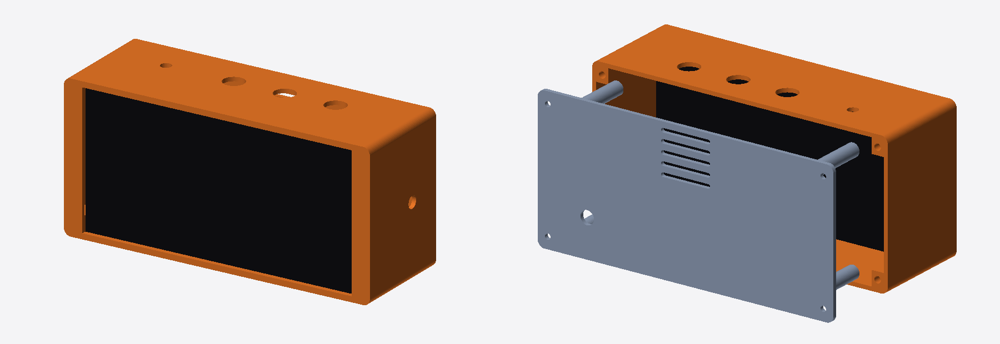

# hey-indicator

Indicateur de disponibilité de bureau à écran LED, dans l'esprit du
[BUSY Bar](https://busy.app/) : une dalle 64x32 affiche **FREE**, **BUSY**,
**ON AIR**, un **HEY!** ou une alerte **URGENT**, plus un minuteur Pomodoro.



La v1 (5 LED, 3 boutons, un interrupteur sur Raspberry Pi) reste dans
l'historique git. La v2 garde ses cinq états et le Raspberry Pi.

## Essayer sans matériel

```sh
pip install Pillow
python3 main.py --sim
```

Le simulateur dessine l'écran dans le terminal. Touches : `f`/`b` free/busy,
`o` on air, `h` hey, `u` urgency, `espace` molette, `r` reset, `+`/`-` minutes,
`q` quitter. L'API et la page web tournent aussi : <http://localhost:8080/>.

## Commandes

| Commande | Effet |
|---|---|
| Interrupteur | Free / Busy |
| Poussoir On Air | bascule l'enseigne On Air (chrono depuis le début) |
| Poussoir Hey | affiche HEY! pendant 10 s, avec un bip |
| Poussoir Urgency | alerte clignotante jusqu'à acquittement (2 min max) |
| Molette, rotation | règle la durée du focus ; ±1 min si le minuteur tourne |
| Molette, appui court | acquitte une alerte, sinon démarre / met en pause |
| Molette, appui long | remet le minuteur à zéro |

Priorité d'affichage : urgency > hey > réglage > on air > minuteur > free/busy.
À la fin du focus (25 min) la pause (5 min) démarre toute seule.

Changements de comportement par rapport à la v1 : On Air bascule au lieu de
suivre l'appui, et Urgency dure jusqu'à acquittement au lieu de 3 secondes.

## API HTTP

Exemples avec un Pi nommé `hey` sur le réseau local :

```sh
curl http://hey.local:8080/api/status
curl -X POST http://hey.local:8080/api/hey -d '{"text": "Réunion dans 5 min ?"}' \
     -H "Authorization: Bearer $HEY_TOKEN"
```

| Route | Corps JSON |
|---|---|
| `GET /` | page de commande pour téléphone ou PC |
| `GET /api/status` | |
| `POST /api/mode` | `{"mode": "free"}` ou `"busy"` |
| `POST /api/on_air` | `{"on": true}` ; sans `on`, bascule |
| `POST /api/hey` | `{"text": "message facultatif"}` |
| `POST /api/urgency` | |
| `POST /api/ack` | |
| `POST /api/timer` | `{"action": "start", "minutes": 25}` ; aussi `pause`, `toggle`, `reset` |
| `POST /api/brightness` | `{"value": 60}` |

Sécurité : si la variable `HEY_TOKEN` est définie, tout `POST` doit porter ce
jeton ; `GET /api/status` reste lisible sans jeton. Le trafic est en HTTP clair
et le service tourne en root (exigé par la dalle) : à garder sur le réseau
local, derrière un jeton.

`tools/onair_watch.py`, lancé sur le PC, passe en On Air quand le micro ou la
webcam sert (Linux, non testé sur une vraie machine).

## Matériel et boîtier

Voir [hardware/README.md](hardware/README.md) : liste de courses, câblage,
installation sur le Pi, boîtier imprimable.



## Organisation du code

| Fichier | Rôle |
|---|---|
| `main.py` | boucle principale |
| `hey/config.py` | broches, durées, textes, couleurs |
| `hey/state.py` | machine à états, sans matériel |
| `hey/render.py`, `hey/font.py` | dessin des écrans |
| `hey/display.py` | dalle HUB75 ou simulateur terminal |
| `hey/inputs.py` | boutons, molette, buzzer, clavier du simulateur |
| `hey/api.py` | API HTTP et page web |

```sh
python3 -m unittest discover -s tests -v   # tests sans matériel
python3 tools/preview.py                   # régénère docs/screens/
```

Licence MIT.
