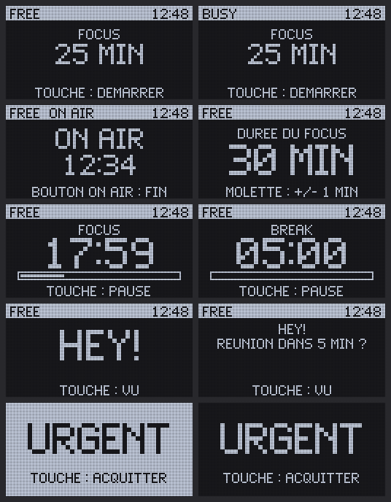
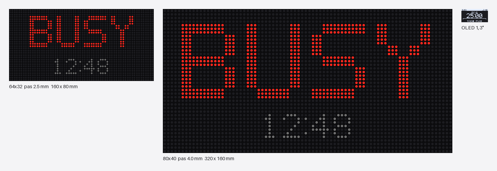
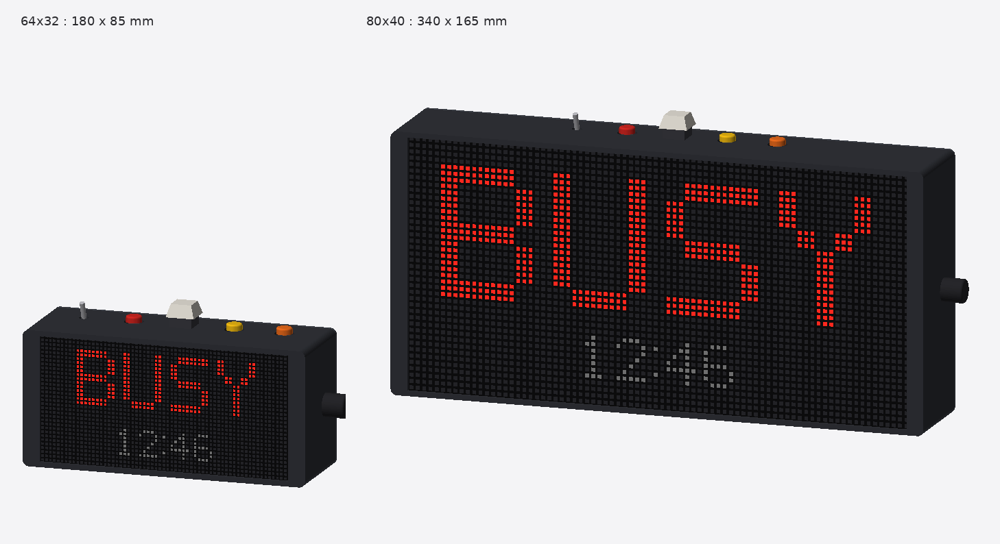

# Matériel

## Pourquoi ce choix

La v1 tournait sur un Raspberry Pi avec 5 LED, 3 boutons et un interrupteur.
La v2 garde le Pi et Python, remplace les 5 LED par une dalle LED RGB, et
reprend deux idées du BUSY Bar : un petit écran monochrome au dos et une
touche de clavier mécanique sur le dessus.

| | BUSY Bar | hey-indicator v2 |
|---|---|---|
| Écran avant | matrice RGB 72x16 | dalle HUB75 64x32 ou 80x40 |
| Écran arrière | OLED monochrome | OLED 1,3" 128x64 (SH1106, I2C) |
| Cerveau | STM32 + puce Wi-Fi | Raspberry Pi Zero 2 W (Wi-Fi, Python) |
| Commandes | touche, sélecteur, molette | touche mécanique, interrupteur Free/Busy, 3 poussoirs, molette |
| Son | haut-parleur | buzzer piézo passif |
| Alimentation | batterie 18650 | secteur 5 V (pas de batterie) |
| API | HTTP locale | HTTP locale (voir `hey/api.py`) |

Non repris : batterie, capteur de luminosité, Bluetooth, Matter.

L'avant s'adresse aux autres (disponible ou pas) ; l'arrière, tourné vers la
personne au bureau, montre le minuteur détaillé, le message « Hey » en
entier, ce que fait la touche et l'adresse de l'API.



## Choisir la dalle

| | 64x32, pas 2,5 mm | Waveshare 80x40, pas 4 mm |
|---|---|---|
| Taille de la dalle | 160 x 80 mm | 320 x 160 mm, 1 kg |
| Boîtier | 180 x 85 x 62 mm | 340 x 165 x 62 mm |
| Plateau d'impression | 185 mm | 345 mm (sinon, couper les pièces) |
| Texte principal | 14 pixels de haut | 21 pixels de haut |
| Balayage | 1/16 | 1/20 : ligne d'adresse E nécessaire |
| Consommation max. | ~4 A (tout blanc) | 20 W, soit 4 A |
| Prix indicatif | 20-30 € | 27 $ chez Waveshare |



La 80x40 se lit de loin et donne des chiffres plus grands, mais elle fait
quatre fois la surface de la 64x32 : c'est un panneau mural ou de bout de
bureau, plus une barre posée devant l'écran. Le choix se fait dans le code
avec `HEY_PANEL=80x40` (ou `--panel 80x40`), et pour le boîtier avec
`python3 hardware/case/hey_case.py 80x40`.

Points propres à la 80x40 :

- **Ligne E** : avec 40 lignes (balayage 1/20), la bibliothèque pilote
  l'adresse E sur le GPIO 24. Sur le RGB Matrix Bonnet, cette ligne n'est
  pas reliée d'origine : il faut souder le pont prévu pour l'E (voir le guide
  Adafruit du bonnet) et vérifier sur la sérigraphie de la dalle quelle
  broche du connecteur HUB75 porte l'E. Je n'ai pas pu le confirmer sur la
  documentation Waveshare.
- **GPIO 24** devient indisponible ; c'est pour cela que le poussoir Hey est
  passé sur le GPIO 18 pour les deux dalles.
- **Alimentation** : prévoir 5 V 6 A (4 A pour la dalle, le reste pour le Pi)
  ou limiter `brightness`. Relier la dalle directement à l'alimentation par
  son propre câble plutôt que de tout faire passer par le bonnet.
- **Raspberry Pi** : la documentation Waveshare ne traite que des Pi 4 et 5,
  avec sa propre copie de la bibliothèque de hzeller. Le Pi Zero 2 W n'y est
  pas mentionné ; la bibliothèque d'origine l'accepte et une seule dalle
  80x40 reste peu gourmande, mais ce n'est pas vérifié.
- **Écran arrière** : un OLED 1,3" paraît petit au dos d'un boîtier de 34 cm.
  Un module 2,42" (SSD1309, même définition 128x64) y serait plus à l'échelle :
  `rear_driver = "ssd1309"` dans `hey/config.py`, et cotes `OLED_*` à
  reprendre dans le script du boîtier.

## Liste de courses

Prix : ordres de grandeur non vérifiés, à contrôler chez ton revendeur.

| Pièce | Rôle | Ordre de prix |
|---|---|---|
| Raspberry Pi Zero 2 WH (connecteur soudé) + microSD 16 Go | cerveau | 30 € |
| Adafruit RGB Matrix Bonnet (réf. 3211) | pilotage de la dalle | 15-20 € |
| Dalle HUB75 64x32 pas 2,5 mm **ou** Waveshare RGB-Matrix-P4-80x40 | écran avant | 20-30 € |
| OLED 1,3" 128x64 SH1106, I2C (4 broches) | écran arrière | 5-8 € |
| Switch mécanique compatible Cherry MX + capuchon (keycap) | touche du dessus | 2-5 € |
| Alimentation 5 V 4 A (64x32) ou 6 A (80x40), fiche 5,5/2,1 mm | dalle + Pi | 12-20 € |
| Embase d'alimentation 5,5/2,1 mm à encastrer avec fiche mâle | traversée du capot | 3 € |
| Encodeur rotatif EC11 avec poussoir + bouton | molette | 2-3 € |
| 3 poussoirs momentanés à encastrer de 12 mm | On Air, Hey, Urgency | 5 € |
| Interrupteur à levier miniature (canon 6 mm) | Free/Busy | 2 € |
| Buzzer piézo passif | sons | 1 € |
| Plaque acrylique fumée 2 mm à la taille de la dalle (facultatif) | contraste, aspect | 5-10 € |
| 4 inserts M3 à chaud, 4 vis M3x8, 4 vis M2,5x6, fils | assemblage | 5 € |

Si tu réutilises le Pi de la v1, vérifie seulement qu'il a un connecteur 40
broches ; ajuste alors `gpio_slowdown` dans `hey/config.py`.

## Câblage

Le bonnet s'enfiche sur le Pi, la nappe HUB75 et les fils d'alimentation de la
dalle se branchent sur le bonnet. Le bonnet alimente aussi le Pi.

Le bonnet occupe les GPIO 4, 5, 6, 12, 13, 16, 17, 20, 21, 22, 23, 26, 27,
plus 24 avec une dalle de 40 lignes. Les broches de la v1 ne sont donc plus
libres :

| Fonction | GPIO (BCM) | Broche | v1 |
|---|---|---|---|
| Interrupteur Free/Busy | 19 | 35 | 19 (inchangé) |
| Touche mécanique | 15 | 10 | nouveau |
| Poussoir On Air | 25 | 22 | 5 |
| Poussoir Hey | 18 | 12 | 6 |
| Poussoir Urgency | 8 | 24 | 13 |
| Molette, voie A | 9 | 21 | nouveau |
| Molette, voie B | 10 | 19 | nouveau |
| Molette, poussoir | 11 | 23 | nouveau |
| Buzzer (+) | 7 | 26 | nouveau |
| OLED SDA | 2 | 3 | nouveau |
| OLED SCL | 3 | 5 | nouveau |
| OLED VCC | 3,3 V | 1 ou 17 | |
| Masse commune | GND | 6, 9, 14, 20, 25, 30, 34, 39 | |

- Chaque contact relie sa broche à la **masse** (pull-up interne). La v1
  reliait au 3,3 V avec pull-down : il faut recâbler.
- Au démarrage, le programme vérifie qu'aucune broche n'est prise deux fois ou
  par la dalle (`Config.check_pins`), et s'arrête avec un message sinon.
- Touche mécanique : les deux pattes du switch vont au GPIO 15 et à la masse.
  Le GPIO 15 est la réception de la liaison série : la laisser désactivée
  (c'est le cas par défaut).
- Les GPIO 7 à 11 sont ceux du SPI : le laisser désactivé (c'est le cas par
  défaut).
- Le pont « qualité » GPIO4-GPIO18 du bonnet prend le GPIO 18 du poussoir
  Hey : si tu le soudes, déplace Hey (par exemple sur le GPIO 24 avec une
  dalle 64x32).
- OLED : activer l'I2C (`sudo raspi-config`, Interface Options) et passer le
  bus à 400 kHz en ajoutant `dtparam=i2c_arm_baudrate=400000` dans
  `/boot/firmware/config.txt`. L'adresse est en général 0x3C
  (`i2cdetect -y 1` pour vérifier).
- Le bonnet ne ressort pas les broches libres : souder les fils sur les pattes
  du connecteur, côté dessous du Pi, ou intercaler un connecteur à broches
  longues.
- Buzzer : un piézo passif se branche directement entre GPIO 7 et la masse.
  Un buzzer magnétique demande un transistor.

## Installation sur le Pi

Non testé sur matériel réel : je n'ai fait tourner que le simulateur, et le
code de la dalle et de l'OLED avec des pilotes factices.

```sh
# Raspberry Pi OS Lite, Wi-Fi et SSH configurés
sudo apt install -y git python3-venv python3-pil python3-gpiozero wget
sudo git clone https://github.com/ellast-eu/hey-indicator /opt/hey-indicator
sudo chown -R "$USER" /opt/hey-indicator
cd /opt/hey-indicator
python3 -m venv env --system-site-packages
source env/bin/activate
pip install luma.oled

# Bibliothèque de la dalle (script Adafruit : choisir « Bonnet » puis « convenience »)
pip3 install adafruit-python-shell
wget https://github.com/adafruit/Raspberry-Pi-Installer-Scripts/raw/main/rgb-matrix.py
sudo -E env PATH=$PATH python3 rgb-matrix.py

sudo env/bin/python main.py                    # dalle 64x32
sudo HEY_PANEL=80x40 env/bin/python main.py    # dalle Waveshare 80x40
```

Image qui scintille : essayer `gpio_slowdown` à 1, 2 ou 3, ou souder le pont
GPIO4-GPIO18 du bonnet et passer `hardware_mapping` à `adafruit-hat-pwm`.

Démarrage automatique : voir `systemd/hey-indicator.service` (y ajouter
`Environment=HEY_PANEL=80x40` pour la grande dalle).

## Boîtier

`case/hey_case.py` (CadQuery) génère `case/out/<dalle>/` :

- `hey-corps.stl`, `hey-capot.stl` : à imprimer tels quels, sans supports ;
- `hey-corps.step`, `hey-capot.step`, `hey-assemblage.step` : pour retoucher en CAO.

`case/render_preview.py` produit les aperçus (`out/<dalle>/apercu.png`,
`out/comparaison.png`).



Dessus, de gauche à droite vu de face : interrupteur Free/Busy, On Air,
touche mécanique au centre, Hey, Urgency. Molette sur le flanc droit. Au dos :
fenêtre de l'OLED, embase d'alimentation, ouïes.

C'est une ébauche à ajuster, pas un boîtier validé :

- les cotes de la dalle (épaisseur, zones d'appui au dos) varient d'un
  fabricant à l'autre ; pour la Waveshare 80x40, l'épaisseur de 15 mm est une
  hypothèse. Waveshare publie un plan coté (fichier DWG dans son dépôt
  `waveshareteam/RGB-Matrix-Px-xx`, dossier `hardware/dimensions`) que je n'ai
  pas pu ouvrir ici ;
- la dalle est plaquée contre la fenêtre par quatre colonnettes du capot,
  elle n'est pas vissée ; avec la 80x40 (1 kg), utiliser plutôt ses trous de
  fixation au dos, à reporter d'après le plan ;
- la touche est une découpe de 14 mm pour switch Cherry MX, avec une paroi
  amincie à 1,5 mm pour les clips ;
- l'OLED est logé dans une cuvette au dos du capot et tenu à la colle chaude ;
  la position de l'écran sur la carte varie selon les modules
  (`OLED_PCB_OFFSET_Y`) ;
- pas de béquille ni d'inclinaison ;
- le boîtier 80x40 demande un plateau de 345 mm : sur une imprimante plus
  petite, il faut couper corps et capot en deux.
